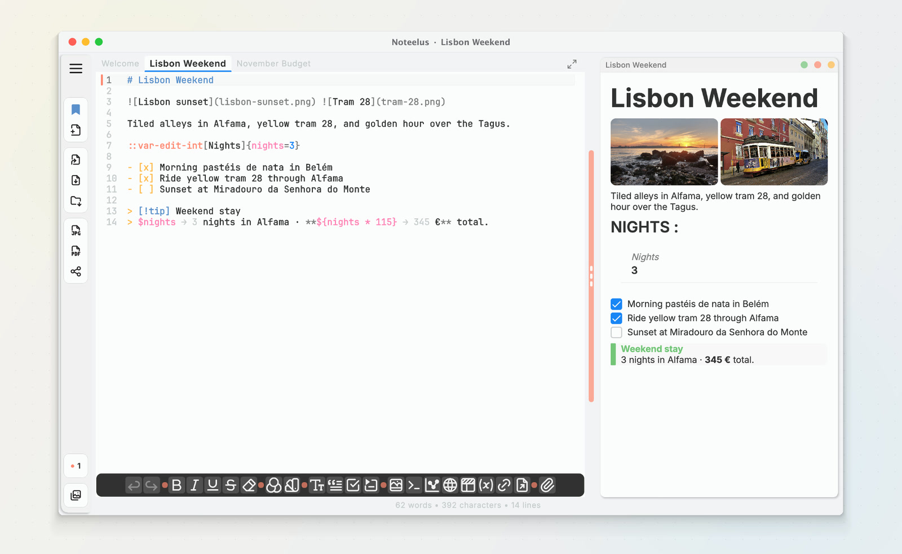
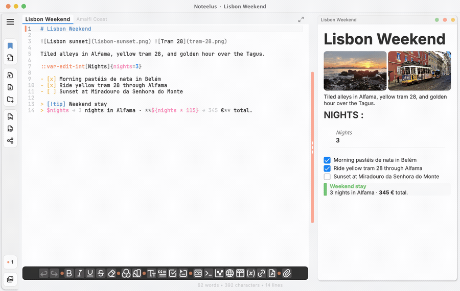
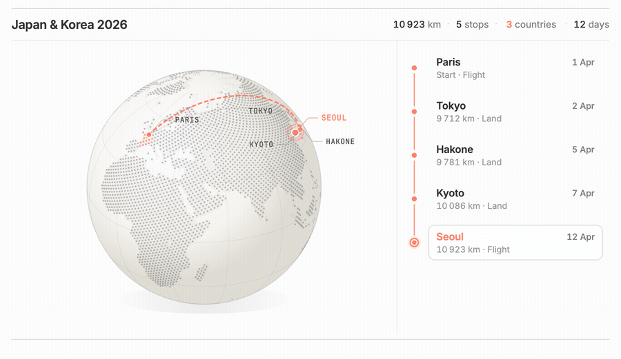
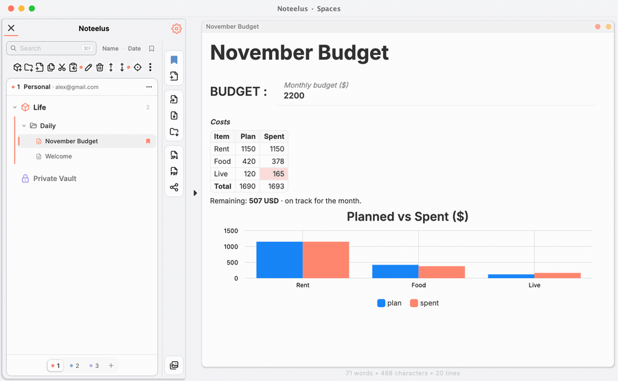
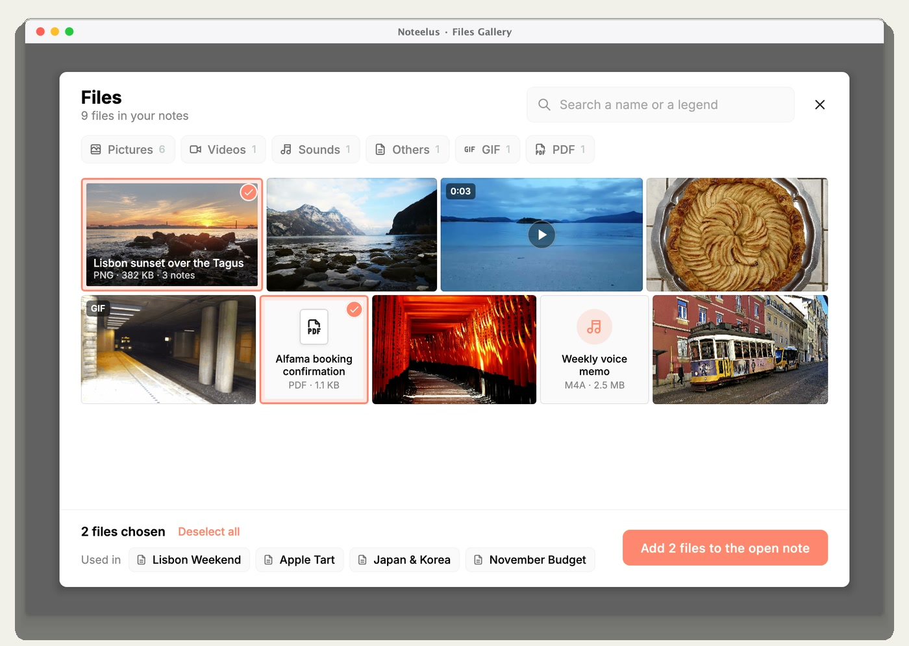
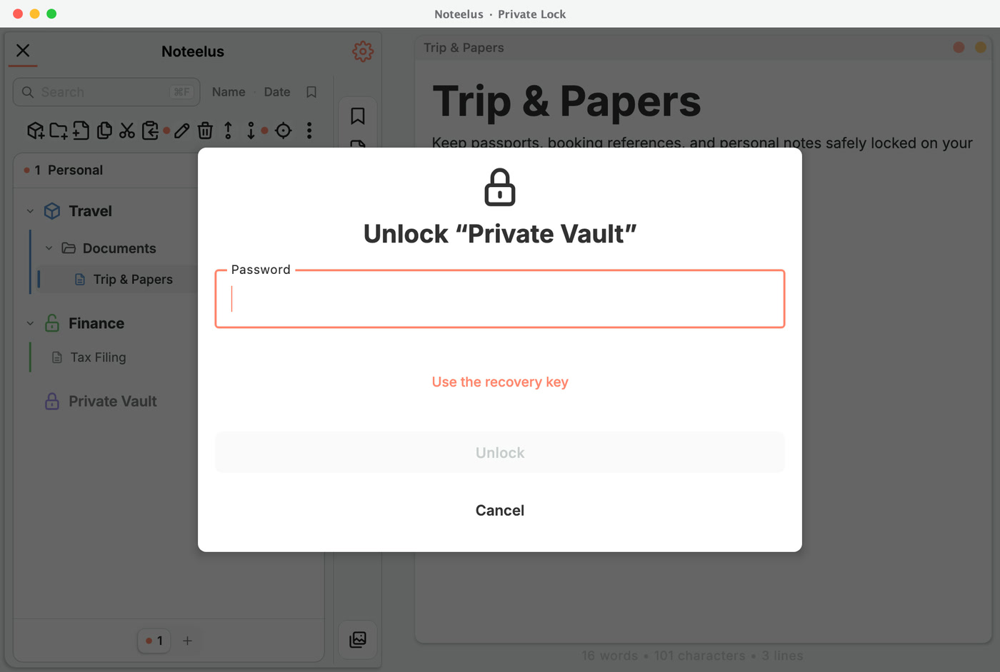
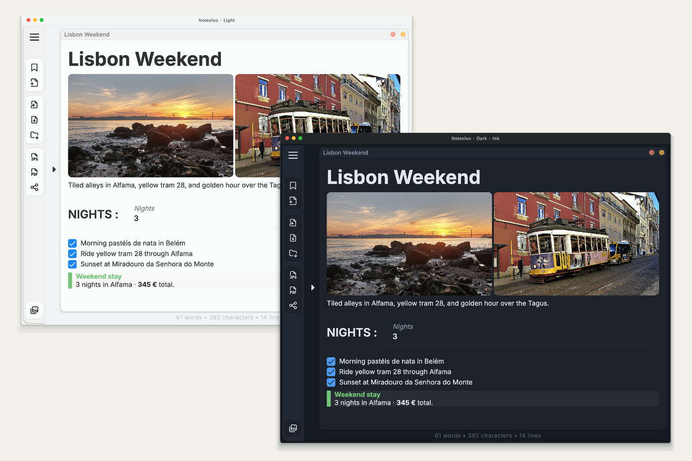

<h1>
  &nbsp;
  Noteelus
</h1>

**Le texte brut qui calcule, cartographie &amp; scelle.**  
Un carnet Markdown *local-first* en Kotlin Multiplatform pour **macOS**, **Windows** et **Android** (iPhone &amp; iPad à suivre).

[Site web](https://noteelus.github.io/?lang=fr) · [Télécharger la bêta](https://noteelus.github.io/download/?lang=fr) · [Notes de version](https://noteelus.github.io/release-notes/?lang=fr) · [English](README.md)



---

## Cinq principes clés

1. **Texte brut, zéro enfermement** : Des notes Markdown lisibles partout avec formules en direct (`::var`, `=sum(...)`), sections pliables et cases interactives.
2. **Cartographie de voyage hors-ligne** : Globes 3D en trame de points (`map-3d`) et cartes Blueprint 2D (`map-2d`) propulsés par Natural Earth et 7 467 lieux embarqués.
3. **Espaces à la Arc** : Séparez *Personnel*, *Travail* et *Voyages* avec arborescences dédiées, accents et comptes Google Drive distincts en option.
4. **Conteneurs chiffrés côté client** : Verrouillez vos dossiers sensibles avec mot de passe dédié et clé de secours affichée une seule fois.
5. **Local-first par défaut** : Sans compte Noteelus, sans serveur Noteelus, sans télémétrie, avec sauvegardes ZIP locales et exports PDF/PNG/Markdown.

---

## 10 lignes de Markdown Noteelus

Tapez du Markdown simple à gauche ; Noteelus évalue les champs, colonnes calculées et graphiques en temps réel à droite :

```markdown
# Budget de novembre

::var[Budget mensuel (€)]{budget=2200}

Table: Dépenses
| Poste | Prévu | Dépensé | Écart |
|:------|------:|--------:|------:|
| Loyer | 1150 | 1150 | =prévu - dépensé |
| Courses | 420 | 378 | =prévu - dépensé |
| Loisirs | 120 | 165 {bg=red} | =prévu - dépensé |
| **Total** | =sum(dépenses.prévu) | =sum(dépenses.dépensé) | =sum(dépenses.écart) |

Reste : **$reste €** ::var-hide{reste=${budget - sum(dépenses.dépensé)}}
```



---

## Cartes de voyage 3D &amp; 2D hors-ligne

Intégrez ` ```map-3d ` ou ` ```map-2d ` dans n'importe quelle note. Les photos importées extraient coordonnées GPS et dates EXIF en local, et le cadrage choisi est conservé dans l'en-tête (`view=lat,lon,zoom`).



---

## Espaces &amp; Galerie unifiée

Passez instantanément entre **Personnel**, **Travail** et **Voyages**, et retrouvez images, GIF, vidéos, mémos vocaux et PDF au même endroit sans dupliquer vos fichiers.





---

## Coffres chiffrés &amp; Quatre thèmes

Scellez un conteneur avec son propre mot de passe et sa clé de secours unique : titres, notes et fichiers restent chiffrés localement et sur Drive. Choisissez entre **Clair**, **Graphite**, **Ink** et **Moka**.





---

## Plateformes prises en charge

| Plateforme | Paquet | Statut bêta | Premier lancement |
|---|---|---|---|
| **macOS** (Apple Silicon &amp; Intel) | `.pkg` | Disponible | Si Gatekeeper alerte : **Réglages Système → Confidentialité et sécurité → Ouvrir quand même**. |
| **Windows 10 / 11** (64 bits) | `.exe` | Disponible | Si SmartScreen apparaît : **Informations complémentaires → Exécuter quand même**. |
| **Android 8+** | `.apk` | Disponible | Depuis les Releases ou depuis l'app bureau (*Réglages → Installer sur mon téléphone*). |
| **iOS / iPadOS** | App Store / TestFlight | En cours | Partage le même cœur Kotlin Multiplatform. |

---

## Réseau &amp; Confidentialité {#privacy}

Noteelus ne contient **ni traceur, ni télémétrie, ni serveur Noteelus** :

- **100 % hors-ligne par défaut** : notes, formules, cartes, exports et conteneurs chiffrés tournent localement.
- **Synchro Google Drive optionnelle** : utilise uniquement le scope limité `drive.file` sur le seul dossier `Noteelus` créé par l'app. Les conteneurs scellés partent déjà chiffrés.
- **Recherche en ligne / blocs `::api`** : uniquement sur action explicite dans une note.

Voir la [Politique de confidentialité](https://noteelus.github.io/privacy.html), les [Conditions d'utilisation](https://noteelus.github.io/terms.html) et les [Licences open-source](THIRD_PARTY_NOTICES.md).

---

## Contact &amp; Bugs

- [Ouvrir une issue GitHub](https://github.com/Noteelus/noteelus.github.io/issues)
- Email : [noteelus-support@googlegroups.com](mailto:noteelus-support@googlegroups.com)
