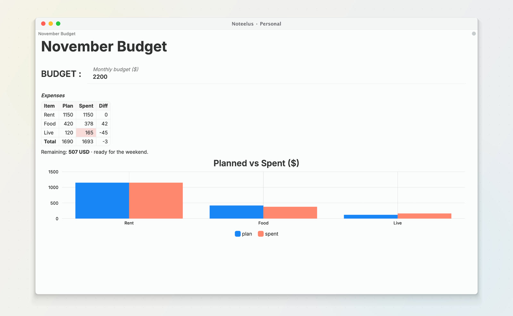
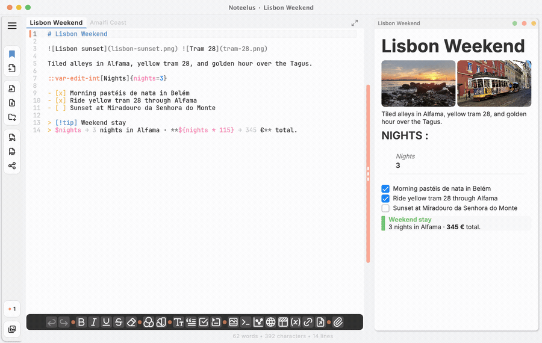
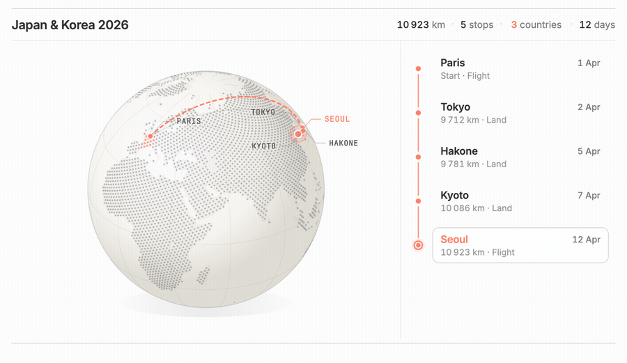
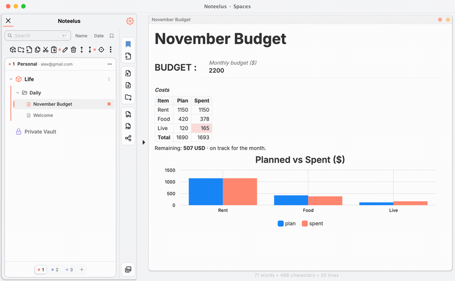
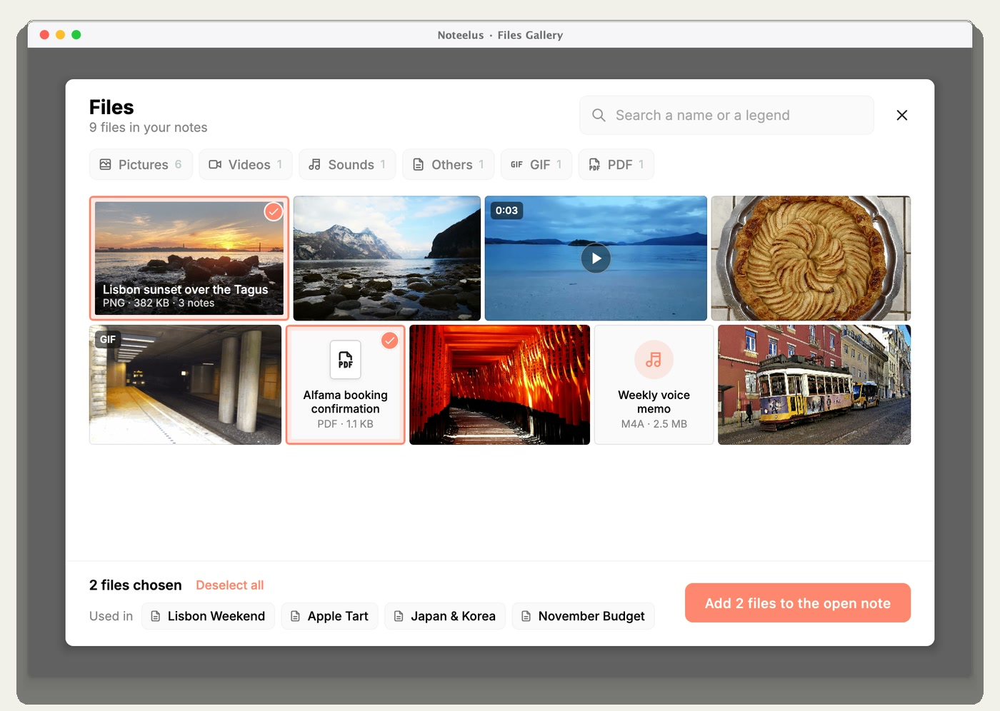
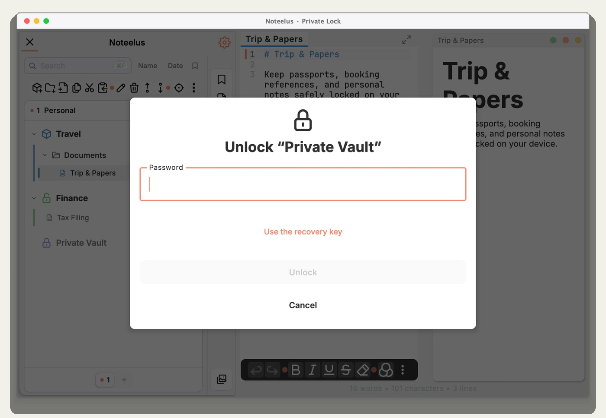
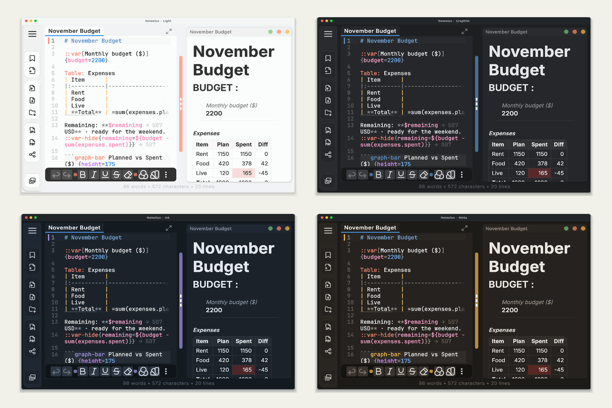

<h1>
  &nbsp;
  Noteelus
</h1>

**Plain-text notes that calculate, map &amp; seal.**  
A local-first Markdown workspace in Kotlin Multiplatform for **macOS**, **Windows**, and **Android** (with iPhone &amp; iPad coming soon).

[Website](https://noteelus.github.io/) · [Download Beta](https://noteelus.github.io/download/) · [Release Notes](https://noteelus.github.io/release-notes/) · [Français](README.fr.md)



---

## Five Core Ideas

1. **Plain text, zero lock-in**: Notes stay readable as clean Markdown with optional inline calculations (`::var`, `=sum(...)`), collapsible sections, and checklists.
2. **Offline travel cartography**: Embed dotted 3D globes (`map-3d`) or 2D architectural blueprints (`map-2d`) powered by bundled Natural Earth coastlines and 7,467 cities.
3. **Arc-style Spaces**: Keep Personal, Work, and Travel apart with dedicated folder trees, accent colors, and optional per-Space Google Drive accounts.
4. **Client-side encrypted containers**: Lock sensitive folders individually with strong authenticated encryption and a one-time recovery key.
5. **Local-first by default**: No Noteelus account, no Noteelus server, no analytics, and automatic local ZIP backups alongside PDF/PNG/Markdown exports.

---

## 10 Lines of Noteelus Markdown

Write standard Markdown on the left; Noteelus evaluates fields, table columns, and charts live on every keystroke:

```markdown
# November Budget

::var[Monthly budget ($)]{budget=2200}

Table: Expenses
| Item | Plan | Spent | Diff |
|:-----|-----:|------:|-----:|
| Rent | 1150 | 1150 | =plan - spent |
| Food | 420 | 378 | =plan - spent |
| Live | 120 | 165 {bg=red} | =plan - spent |
| **Total** | =sum(expenses.plan) | =sum(expenses.spent) | =sum(expenses.diff) |

Remaining: **$remaining USD** ::var-hide{remaining=${budget - sum(expenses.spent)}}
```



---

## Offline 3D &amp; 2D Journey Maps

Drop ` ```map-3d ` or ` ```map-2d ` directly into any note. Photos carry GPS coordinates and timestamps automatically via local EXIF extraction, and panning/zooming persists right in the note header (`view=lat,lon,zoom`) for clean PDF exports.



---

## Spaces &amp; Unified Media Library

Hop across **Personal**, **Work**, and **Travel** Spaces without mixing client notes or recipes, and browse every photo, GIF, video, voice memo, and PDF across your workspace from one deduplicated gallery.





---

## Zero-Knowledge Vaults &amp; Four Themes

Seal any container with its own password and one-time recovery key: titles, bodies, and attachments stay encrypted on disk and inside Google Drive. Work comfortably in **Light**, **Graphite**, **Ink**, or **Moka**.





---

## Supported Platforms

| Platform | Package | Beta Status | First-Launch Note |
|---|---|---|---|
| **macOS** (Apple Silicon) | `.pkg` | Available | If Gatekeeper warns for an unverified developer, open **System Settings → Privacy &amp; Security → Open Anyway**. |
| **Windows 10 / 11** (64-bit) | `.exe` | Available | If SmartScreen appears, choose **More info → Run anyway**. |
| **Android 8+** | `.apk` | Available | Install directly from Releases or transfer from Desktop via *Settings → Install on my phone*. |
| **iOS / iPadOS** | App Store / TestFlight | In progress | Shares the same Kotlin Multiplatform core and Drive sync format. |

---

## Network &amp; Privacy Transparency {#privacy}

Noteelus ships **zero analytics, zero telemetry, and zero Noteelus backend servers**:

- **Offline by default**: Notes, formulas, charts, maps, exports, and encrypted containers run 100% locally.
- **Optional Google Drive sync**: Uses strictly the non-sensitive `drive.file` OAuth scope, interacting only with the `Noteelus` folder created by the app. Sealed containers upload already encrypted.
- **Optional map lookup / `::api` blocks**: Online city geocoding (Photon OSM) or user-written `::api` fetches only run when explicitly triggered inside a note.

Read the full [Privacy Policy](https://noteelus.github.io/privacy.html), [Terms of Use](https://noteelus.github.io/terms.html), and [Third-Party Open-Source Notices](THIRD_PARTY_NOTICES.md).

---

## Support &amp; Issues

- [Report a bug or request a feature](https://github.com/Noteelus/noteelus.github.io/issues)
- Email: [noteelus-support@googlegroups.com](mailto:noteelus-support@googlegroups.com)
